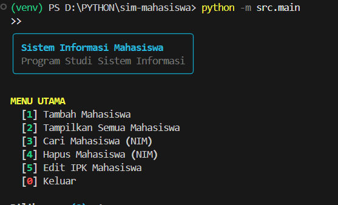
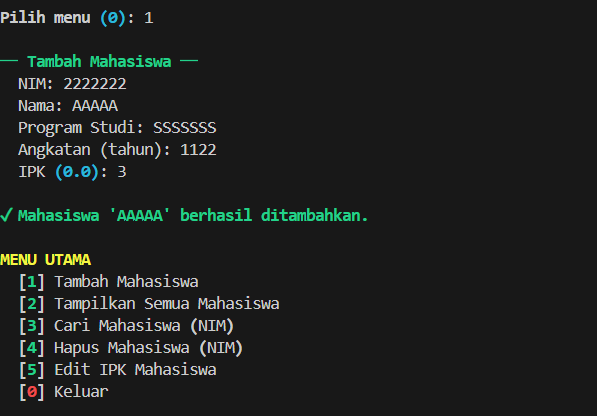
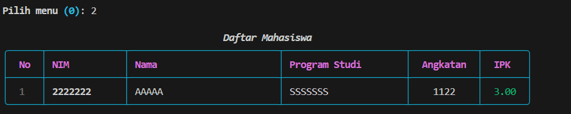

# Sistem Informasi Mahasiswa (SIM)

> Aplikasi console-based untuk manajemen data mahasiswa, dibuat dengan Python 3.10+ dan library [Rich](https://github.com/Textualize/rich).

---

## Identitas

| Field | Keterangan |
|---|---|
| **Nama** | `AHMAD SAHRUL F` |
| **NIM** | `20241320031` |
| **Kelas** | `A1` |
| **Mata Kuliah** | Praktikum Pemrograman Modern Python |
| **Program Studi** | Sistem Informasi |

---

## Deskripsi

SIM adalah aplikasi berbasis terminal yang memungkinkan pengguna mengelola data mahasiswa secara interaktif. Proyek ini dirancang sebagai latihan praktikum untuk memahami:

- Struktur proyek Python yang baik
- Penggunaan virtual environment
- Penulisan kode mengikuti standar (Black + Ruff)
- Unit testing dengan Pytest
- Version control dengan Git & GitHub

---

## Screenshots / Demo

### Menu Utama


### Tambah Mahasiswa


### Tabel Daftar Mahasiswa


---

## Fitur

- **Tambah Mahasiswa** — Input data lengkap dengan validasi
- **Tampilkan Semua** — Tabel berwarna menggunakan Rich
- **Cari Mahasiswa** — Berdasarkan NIM
- **Hapus Mahasiswa** — Berdasarkan NIM
- **Edit IPK** — Perbarui IPK dengan validasi rentang 0.0–4.0

---

## Prasyarat

| Kebutuhan | Versi Minimum |
|---|---|
| Python | 3.10+ |
| pip | terbaru |
| Git | 2.x |

---

## Instalasi

### 1. Clone repositori

```bash
git clone https://github.com/<username>/sim-mahasiswa.git
cd sim-mahasiswa
```

### 2. Buat dan aktifkan virtual environment

```bash
# Buat venv
python -m venv venv

# Aktifkan (Windows)
venv\Scripts\activate
```

### 3. Install dependensi

```bash
pip install -r requirements.txt
```

---

## Penggunaan

Jalankan program dari root direktori proyek:

```bash
python -m src.main
```

Ikuti menu interaktif yang muncul di terminal.

---

## Pengujian

```bash
# Jalankan semua test
pytest tests/ -v

# Jalankan dengan laporan coverage (opsional)
pytest tests/ -v --tb=short
```

---

## Struktur Proyek

```
sim-mahasiswa/
├── src/
│   ├── __init__.py       # Package marker
│   ├── models.py         # Dataclass Mahasiswa & DaftarMahasiswa
│   └── main.py           # Entry point — menu interaktif
├── tests/
│   ├── __init__.py       # Package marker
│   └── test_main.py      # Unit test (14 test case)
├── docs/                 # Dokumentasi tambahan
├── .gitignore            # File yang diabaikan Git
├── requirements.txt      # Daftar dependensi
└── README.md             # Dokumentasi ini
```

---

## Setup Checklist

- [ ] Python 3.10+ terinstall (`python --version`)
- [ ] pip terinstall (`pip --version`)
- [ ] Git terinstall (`git --version`)
- [ ] Virtual environment dibuat (`python -m venv venv`)
- [ ] Virtual environment diaktifkan (`venv\Scripts\activate`)
- [ ] Dependensi terinstall (`pip install -r requirements.txt`)
- [ ] Program berjalan tanpa error (`python -m src.main`)
- [ ] Semua test lulus (`pytest tests/ -v`)
- [ ] Repository Git diinisialisasi (`git init`)
- [ ] Remote GitHub terhubung (`git remote add origin <url>`)
- [ ] Kode berhasil dipush ke GitHub (`git push -u origin main`)

---

## Lisensi

Proyek ini dibuat untuk keperluan akademis. Bebas digunakan dan dimodifikasi.
